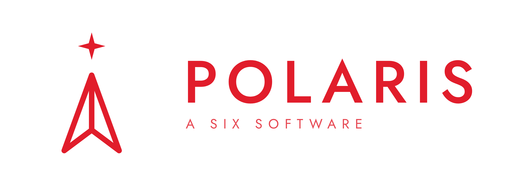
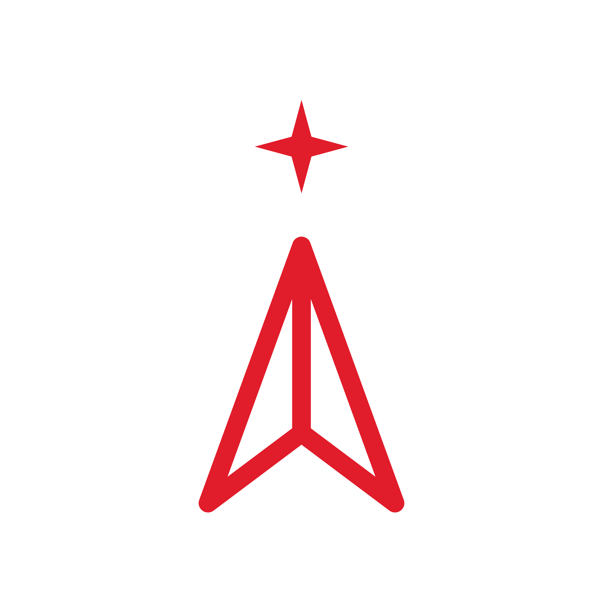

<div align="center">



### The Next Generation of Wealth Advisory

*The guiding star for the wealth manager.*

</div>

---

**Polaris** is a wealth-manager (**WM**) workbench for the **SIX · Noumena · NTT Data**
challenge *"The Next Generation of Wealth Advisory."* It turns the firehose of market
news into a focused, per-client action queue: the WM sees what changed for each client,
understands **why** (news → analysis → advice → action), and acts in one click — while
the client always decides.

Three apps work together as one product:

| Folder | What it is |
|---|---|
| `frontend/` | React + Vite + TypeScript SPA — the WM dashboard |
| `server/` | Express + SQLite backend — the UML entities + WM use cases, with real persistence |
| `system/` | LangGraph multi-agent system — the inference that produces news, analysis and suggestions |

The full loop is live and integrated: the agent graph reasons over each client's DNA,
the CIO mandate and live news, writes suggestions into the workbench, and the WM applies
or rejects them from the dashboard — every decision flowing back to evaluate plan quality.

---

## Architecture

```
        data/*.xlsx ──seed──▶  SQLite (server/data/workbench.db)
                                     │
   ┌────────────────────────┐        │  REST  /api/*
   │  system/ (LangGraph)   │◀──────▶│
   │  multi-agent inference │   Express API (server, :4000)
   │  • client DNA          │        │
   │  • CIO plan            │        │  /api/*  (Vite proxy)
   │  • news (GraphRAG)     │        ▼
   │  • create / explain    │   React SPA (frontend, :5173)
   │  • evaluate plan       │        │
   └────────────────────────┘        ▼
                                 Wealth Manager
                              (applies / rejects)
```

- **Frontend → API:** `frontend/src/lib/api.ts` (fetch) + `lib/queries.ts` (react-query).
  Mutations invalidate `dashboard`/`customer` queries so the UI refetches automatically.
- **API → DB:** `server/src/index.ts` (routes), `server/src/repo.ts` (drift + apply/drop),
  `server/src/schema.ts` (DDL), `server/src/seed.ts` (xlsx → rows).
- **System → API:** the LangGraph agents read client/portfolio/CIO data from the workbench
  API, retrieve news through GraphRAG, and write back suggestions and tailored client
  messages. See `system/README.md` for the agent graph.

---

## Run it

### Prerequisites

- **Node 22.12+** and npm (`.nvmrc` pins 22.12.0 in `frontend/`)
- **Python 3.11+** (for the advisory system)
- **Docker** (for GraphRAG)

### 1. Backend — seeds the SQLite DB from `data/*.xlsx` on first boot

```bash
cd server
npm install
npm run dev            # http://localhost:4000
```

### 2. Frontend — Vite dev server, proxies `/api` → `http://localhost:4000`

```bash
cd frontend
npm install
npm run dev            # http://localhost:5173
```

Open **http://localhost:5173**.

### 3. Advisory system — the multi-agent inference

```bash
cd system
cp .env.example .env   # set your LLM endpoint + key
pip install -e ".[dev]"
docker compose up -d   # GraphRAG
python -m src.main
```

To rebuild the database from the workbooks at any time:

```bash
cd server && npm run seed -- --reset
```

A single-origin production image (frontend served by the backend) is provided via the
root `Dockerfile` and `render.yaml`.

---

## The use cases (UML)

| Use case | Endpoint |
|---|---|
| Get dashboard data (+ TLDR news) | `GET /api/dashboard` |
| Get client | `GET /api/customers/:id` |
| Add client data (comment) | `POST /api/customers/:id/comments` |
| Apply suggestion (records a transaction, swaps the holding) | `POST /api/suggestions/:id/apply` |
| Drop suggestion | `POST /api/suggestions/:id/drop` |
| Run advisory pipeline for a client | `POST /api/system/trigger` |
| Submit WM decision (HITL) | `POST /api/system/hitl` |

Per the brief, **news is shown on the WM dashboard, not inside the client view**
(even though the UML lists "get TLDR news" under "get client").

---

## App map

- **Dashboard** (`/`) — clients overview, action queue (pending suggestions), market
  signals (TLDR news). `frontend/src/pages/DashboardPage.tsx`
- **Clients** (`/clients`) — the book. `ClientsPage.tsx`
- **Client detail** (`/clients/:id`) — tabs: Holdings (donut + table), Suggestions
  (apply/drop), History, Relationship · DNA (CRM log + add data). `ClientDetailPage.tsx`
- **Action queue** (`/alerts`) — cross-book pending suggestions.

The advisory graph (`system/`) drives eight agents end-to-end:
`get_client_dna → get_cio_plan → get_current_plan → fetch_news → check_actions →
create_plan → explain_plan → evaluate_plan`, with the WM in the loop between explain and
evaluate.

---

## Design

Palette follows the SIX reference UI: light neutral canvas, white cards, **SIX red** as
the accent (active nav, primary actions, alerts), green for positive figures. Tokens live
in `frontend/src/index.css`. Type: Bricolage Grotesque (display) · Inter (body) ·
IBM Plex Mono (tabular figures). Brand assets live in `frontend/public/brand/`.

<div align="center">



**Polaris** — the WM's true north.

</div>
